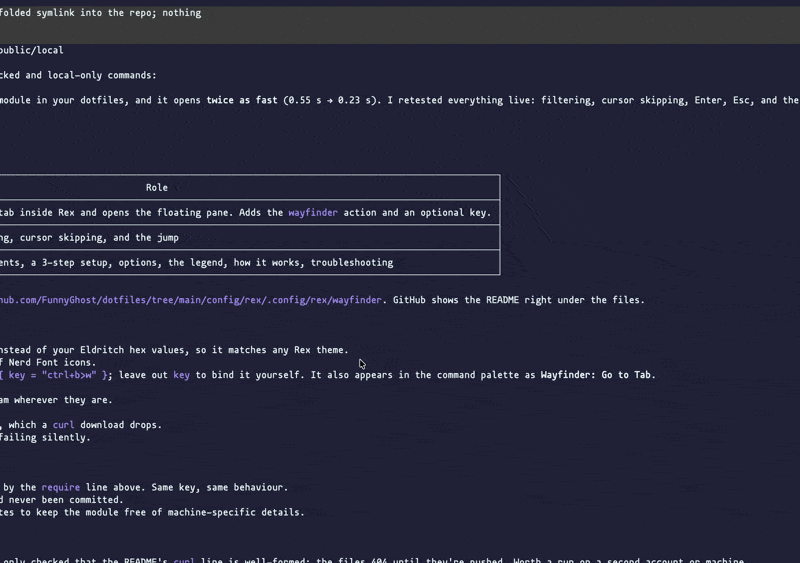

# 🧭 Wayfinder

A tab picker for [Rex](https://www.superlogical.com/rex). One key opens a
floating list of **every tab in every session**, grouped by session, each
marked as an agent or a terminal with its status. Type to filter, Enter to
jump.



Rex's own switcher (Cmd+K) lists sessions only. Wayfinder lists the tabs
inside them, and shows which agents are working, waiting on you, or done.

## Requirements

- Rex, with `init.lua` config (`~/.config/rex/`).
- A recent [fzf](https://github.com/junegunn/fzf) (tested with 0.74):
  `brew install fzf`.
- Optional: a [Nerd Font](https://www.nerdfonts.com) as Rex's terminal font,
  for the agent and terminal icons. Without one, use `icons = "plain"`.

## Setup

1. Put the two files in a `wayfinder` folder beside your `init.lua`:

   ```sh
   mkdir -p ~/.config/rex/wayfinder && cd ~/.config/rex/wayfinder
   base=https://raw.githubusercontent.com/FunnyGhost/dotfiles/main/config/rex/.config/rex/wayfinder
   curl -fsSL -O "$base/init.lua" -O "$base/picker.sh"
   ```

2. Load it from `~/.config/rex/init.lua`, choosing your key:

   ```lua
   require("wayfinder").setup{ key = "ctrl+b>w" }
   ```

3. Reload: `rex config reload`, or **Reload Config** in the command palette.

It's also in the command palette as **Wayfinder: Go to Tab**.

## Options

```lua
require("wayfinder").setup{
  key = "ctrl+b>w",                -- any Rex key or sequence; leave out to bind it yourself
  bounds = { 0.32, 0.2, 0.36, 0.5 }, -- x, y, width, height, as fractions of the window
  icons = "nerd",                  -- "nerd", or "plain" without a Nerd Font
}
```

Without `key`, bind the `wayfinder` action yourself:
`rex.bind("cmd+shift+o", "wayfinder")`.

Colors come from your terminal palette, so Wayfinder follows your Rex theme.

## Using it

| Key | Does |
| --- | --- |
| Type | Filter: every word must appear in the session or tab name. A matching session keeps all its tabs. |
| ↑ ↓ | Move between tabs. Session names are headings, and the cursor skips them. |
| Enter | Jump to the tab, in whichever session it's in. |
| Esc | Close. |

| Mark | Agent 󰚩 | Terminal 󰆍 |
| --- | --- | --- |
| Cyan ● | Running | Running a command |
| Red ● | Needs you: a permission or a question | — |
| Green ● | Done, and you haven't looked yet | — |
| · | Idle | At a prompt |
| ✕ | Failed | — |

Your current tab is shown in bold green.

## How it works

- **Agent or terminal.** A tab is an agent when a pane in it reports a status
  with the [Program Status Protocol](https://www.superlogical.com/rex/docs/build/program-status.md)
  (OSC 7501), as Claude Code does in Rex. With several panes, the most urgent
  status wins. Any other tab is a terminal, running while one of its panes runs
  something other than a shell.
- **Tab names.** A tab you named shows its name. An unnamed tab shows its
  terminal title, which is usually what the program in it is doing.
- **Two halves.** `init.lua` runs inside Rex: it collects the tabs through
  Rex's API, which is what makes it open quickly, and opens a floating pane.
  `picker.sh` runs fzf in that pane and jumps with `rex do session.select`.
  Rex has no picker API of its own, so the picker is a terminal program.

## Troubleshooting

- **Nothing happens on the key.** Check `rex keymap | grep wayfinder` and
  `rex config check` for errors.
- **"Wayfinder needs fzf".** Install fzf; the pane says so and waits for a key.
- **Boxes instead of icons.** Your terminal font has no Nerd Font glyphs:
  set `icons = "plain"`.
